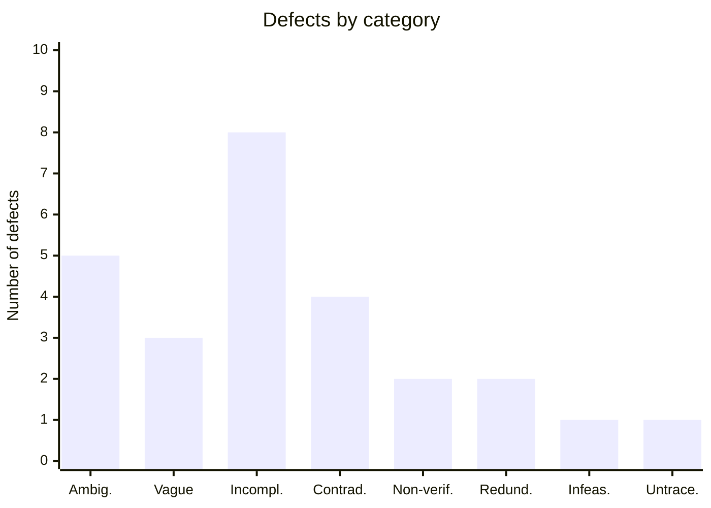

# Summary

Counts taken from defect-log.md (26 defects, before adding partner findings).

## Defects by category and severity

| Category | High | Medium | Low | Total |
|---|---|---|---|---|
| Ambiguity | 1 | 4 | 0 | 5 |
| Vagueness | 2 | 1 | 0 | 3 |
| Incompleteness | 2 | 6 | 0 | 8 |
| Contradiction | 2 | 2 | 0 | 4 |
| Non-verifiability | 1 | 1 | 0 | 2 |
| Redundancy | 0 | 0 | 2 | 2 |
| Infeasibility | 0 | 0 | 1 | 1 |
| Untraceability | 0 | 0 | 1 | 1 |
| **Total** | **8** | **14** | **4** | **26** |

## Chart: defects by category

